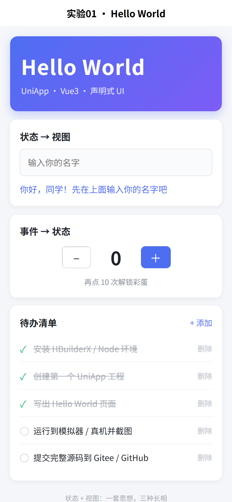
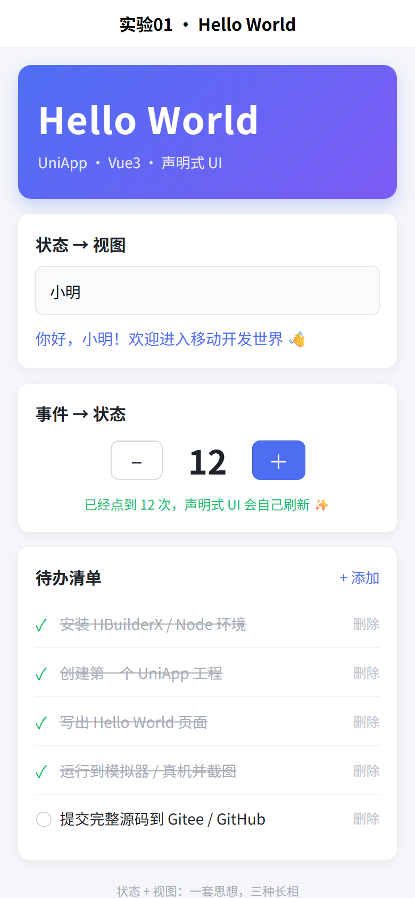

# 实验01 · 移动开发环境搭建与端实现（UniApp + Vue3）

> 课程：移动应用开发　实验：01　主攻框架：**UniApp（Vue3 + Vite）**
> 一句话：用一套 Vue3 代码，同时编译到 H5 / 微信小程序 / Android·iOS App 三端，并用**声明式 UI**写出第一个 Hello World 页面。



## 一、环境与技术栈

| 项目 | 版本 / 说明 |
| --- | --- |
| 操作系统 | Windows 11 |
| Node.js | v24.17.0（uni-app CLI 工程必需） |
| 包管理器 | npm 11.x（镜像 `registry.npmmirror.com`） |
| 构建工具 | Vite 5.2.8 + `@dcloudio/vite-plugin-uni` |
| 框架 | uni-app（Vue3 编译器 5.36）+ Vue 3.5 |
| 编辑器 | VS Code（可选 HBuilderX 图形化运行） |
| 版本控制 | Git → Gitee / GitHub |

环境搭建步骤（本机实际执行）：

```bash
# 1. 安装 Node（已装则跳过），验证
node -v          # v24.17.0
npm -v           # 11.x

# 2. 进入工程目录，安装依赖
npm install      # 国内可加 --registry=https://registry.npmmirror.com

# 3. 启动 H5 开发服务器（热更新）
npm run dev:h5   # 打开 http://127.0.0.1:5180/
```

## 二、目录结构

```
exp01-uniapp-hello/
├─ index.html                  # H5 端宿主页面（仅 H5 使用）
├─ package.json                # 依赖与脚本（dev:h5 / dev:mp-weixin / dev:app）
├─ vite.config.js              # Vite + uni 插件配置、开发端口
├─ .gitignore                  # 忽略 node_modules、dist、unpackage
├─ src/
│  ├─ main.js                  # 应用入口：导出 createApp()，三端统一
│  ├─ App.vue                  # 根组件：全局生命周期 onLaunch/onShow/onHide + 全局样式
│  ├─ pages.json               # 页面路由表 + 窗口样式（页面必须在此注册）
│  ├─ manifest.json            # 应用配置：应用名、appid、版本、各端打包参数
│  ├─ uni.scss                 # 全局 SCSS 变量，页面样式可直接使用
│  └─ pages/
│     └─ index/
│        └─ index.vue          # 首页：<template> 视图 + <script setup> 状态 + <style scoped>
└─ docs/
   ├─ 实验报告.md              # 提交用实验报告（含三框架对比、运行截图）
   ├─ 提交说明.md              # Git 仓库初始化 / 推送 Gitee·GitHub 步骤
   └─ screenshots/             # 运行效果截图
```

## 三、关键文件的作用

| 文件 | 作用 | 类比 |
| --- | --- | --- |
| `src/main.js` | 应用入口，导出 `createApp()` 由编译器在各端调用 | Android 的 `Application` / Flutter 的 `main()` |
| `src/App.vue` | 根组件，挂应用级生命周期与全局样式 | Flutter 的根 `MaterialApp` |
| `src/pages.json` | **路由表**：`pages` 数组第一项即启动页；`globalStyle` 统一定义导航栏 | Android 的 `AndroidManifest.xml` + Flutter 的 `routes` |
| `src/manifest.json` | 应用元信息与**各端打包参数**（小程序 appid、App 权限、H5 路由模式） | Android 的 `build.gradle` + `AndroidManifest` 合并体 |
| `src/pages/index/index.vue` | 页面单文件组件：模板（视图）/ 脚本（状态与逻辑）/ 样式（scoped 隔离） | Android 的 `Activity` + `layout.xml` |
| `src/uni.scss` | 全局 SCSS 变量（颜色、间距），编译期注入各页面 | Flutter 的 `ThemeData` |
| `index.html` | H5 端唯一 HTML 宿主，挂载 `#app` | Web 项目的入口页 |
| `vite.config.js` | 构建配置，注册 `uni()` 插件、指定端口 | Flutter 的构建脚本 |

## 四、Hello World：声明式 UI 的四个要点

`src/pages/index/index.vue` 不是"先拿到 DOM 再 `innerHTML = ...`"，而是**只描述界面与数据的关系**：

```vue
<template>
  <!-- ③ 插值：视图 = f(状态) -->
  <text class="greeting">{{ greeting }}</text>

  <!-- ② 双向绑定：输入框 ↔ nickname -->
  <input v-model="nickname" placeholder="输入你的名字" />

  <!-- ④ 事件驱动：点击只改 count，界面自动刷新 -->
  <button @click="count++">＋</button>
  <text>{{ count }}</text>

  <!-- ⑤ 条件 / 列表渲染 -->
  <text v-if="count >= 10">已点到 {{ count }} 次</text>
  <view v-for="(item, i) in todos" :key="item.id">{{ item.text }}</view>
</template>

<script setup>
import { ref, computed } from 'vue'
const nickname = ref('')                 // 状态
const count = ref(0)                     // 状态
const todos = ref([{ id: 1, text: '第一个任务', done: false }])
const greeting = computed(() => nickname.value ? `你好，${nickname.value}！` : '你好，同学！')
</script>
```

**声明式的本质**：状态（`ref`）是唯一数据源，视图是它的映射；改状态 → 框架计算出最小 DOM 更新。不需要 `document.querySelector`、不需要手动 `setText`。

运行效果（输入名字、连点 12 次、勾选待办后的状态）：



## 五、运行到目标端

| 端 | 命令 | 说明 |
| --- | --- | --- |
| **H5（已实测）** | `npm run dev:h5` | 浏览器访问 `http://127.0.0.1:5180/`，本仓库截图即该端运行结果 |
| 微信小程序 | `npm run dev:mp-weixin` | 产物在 `dist/dev/mp-weixin`，用微信开发者工具"导入项目"打开 |
| Android / iOS App | `npm run dev:app` | 用 HBuilderX 打开本工程 → 运行 → 运行到手机或模拟器（USB 调试 / 模拟器 / 真机基座） |
| 生产构建 | `npm run build:h5`（另可 `build:mp-weixin` / `build:app`） | 产物在 `dist/build/` |

> 说明：本机未安装 HBuilderX / Android 模拟器，故 App 端与小程序端的"运行到设备"需按上表在本地补一步；H5 端已完整跑通并有截图，页面逻辑三端共用。

## 六、提交要求对照

| 要求 | 完成情况 |
| --- | --- |
| 搭建主攻框架开发环境 | ✅ Node + npm + Vite + uni-app CLI 工程可运行（HBuilderX 可选） |
| 创建第一个工程、看懂标准目录结构 | ✅ 见"二、目录结构""三、关键文件的作用" |
| 声明式 UI 写 Hello World 页面 | ✅ `src/pages/index/index.vue`，状态/绑定/事件/条件/列表五类语法 |
| 运行到目标端 | ✅ H5 端实测运行并截图（`docs/screenshots/`） |
| 体会三框架"一套思想、三种长相" | ✅ 见 `docs/实验报告.md` 第三节 |
| 用版本控制提交到 Gitee / GitHub | ✅ 本地 Git 仓库已初始化并提交，推送步骤见 `docs/提交说明.md` |
| 附仓库链接 | ⬜ 需你推送后把链接填到 `docs/提交说明.md` 与答题框 |

## 七、常见问题

1. **`npm install` 报 `EPERM: mkdir ... npm-cache`**：缓存目录被系统/沙箱限制，加 `--cache ./.npm-cache` 落到工程内即可。
2. **`Error: spawn EPERM`（esbuild 启动失败）**：运行环境禁止创建子进程或管道，需在正常终端（或放行权限的沙箱）中执行 `npm run dev:h5`。
3. **页面样式 1px 偏差**：uni-app 用 `rpx`（750 设计稿基准），`32rpx` 在 390px 宽屏幕上 ≈ 16.6px，属预期。
4. **改了 `pages.json` 要重启**：路由表与窗口配置在启动时读取，热更新不生效时重启 dev server。
