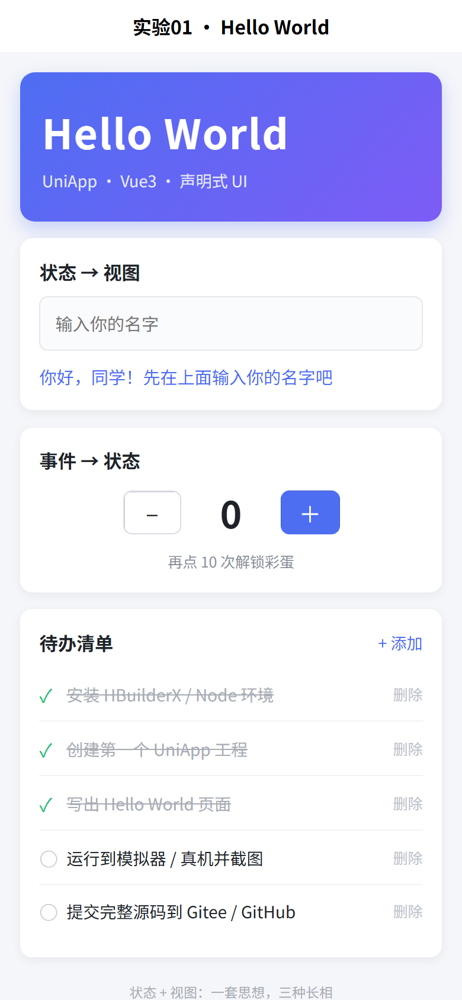
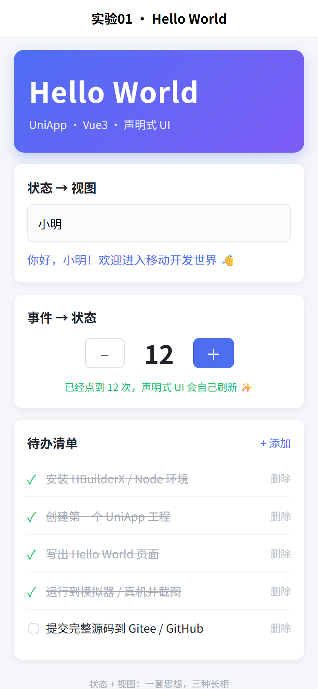

# 实验01 实验报告：移动开发环境搭建与端实现

| 项目 | 内容 |
| --- | --- |
| 课程 | 移动应用开发 |
| 实验 | 实验01 移动开发环境搭建与端实现 |
| 主攻框架 | **UniApp（Vue3 + Vite）** |
| 姓名 / 学号 | （提交前填写） |
| 实验时间 | 2026-11-09 |
| 仓库地址 | **https://github.com/colacolaco/exp01-uniapp-hello** |

---

## 一、实验目的

1. 独立搭建本小组主攻框架（UniApp / HarmonyOS / Flutter 中任选）的开发环境，按官方文档完成安装与配置。
2. 创建第一个工程，看懂标准目录结构，说清入口、配置、页面三类关键文件的作用。
3. 用声明式 UI 写出 "Hello World" 页面，并成功运行到目标端（模拟器或真机）。
4. 初步体会三框架"一套思想、三种长相"：都是"状态 + 视图"的编程模型，只是界面写法不同。
5. 学会使用版本控制，把第一个工程提交到 Gitee / GitHub 仓库。

## 二、实验环境

### 2.1 软硬件

| 类别 | 配置 |
| --- | --- |
| 操作系统 | Windows 11（x64） |
| Node.js | v24.17.0 |
| npm | 11.17.0（镜像 `https://registry.npmmirror.com`） |
| 构建工具 | Vite 5.2.8 |
| 框架 | uni-app（编译器 5.36，Vue3 版本）+ Vue 3.5 |
| 关键依赖 | `@dcloudio/uni-app`、`@dcloudio/uni-h5`、`@dcloudio/uni-mp-weixin`、`@dcloudio/vite-plugin-uni`、`sass` |
| 编辑器 | VS Code（HBuilderX 作为可选图形化运行器） |
| 运行目标端 | H5（浏览器，本机实测）；微信小程序 / Android 见 6.2 |
| 版本控制 | Git 2.x |

### 2.2 环境搭建过程

1. **安装并验证 Node/npm**：`node -v` → `v24.17.0`，`npm -v` → `11.17.0`。Node 提供 npm 与 Vite 运行所需的 JS 运行时。
2. **配置镜像源**：`npm config set registry https://registry.npmmirror.com`，避免默认源在国内拉包超时。
3. **创建 CLI 工程**：按官方 `uni-preset-vue#vite` 模板的项目结构手工落地（`package.json` + `src/` + `index.html` + `vite.config.js`），依赖版本与官方模板保持一致（`vite` 必须为插件 peer 要求的 `5.2.8`）。
4. **安装依赖**：`npm install`（过程问题见第八节），共 577 个包。
5. **启动开发服务器**：`npm run dev:h5` → `http://127.0.0.1:5180/`，页面热更新正常。
6. **生产构建验证**：`npm run build:h5` → `dist/build/h5`，产物 162 KB；`npm run build:mp-weixin` → `dist/build/mp-weixin`，可导入微信开发者工具。

### 2.3 工程创建与启动命令

```bash
npm install                 # 安装依赖
npm run dev:h5              # H5 开发：http://127.0.0.1:5180/
npm run dev:mp-weixin       # 微信小程序开发：产物 dist/dev/mp-weixin
npm run dev:app             # App 开发：需 HBuilderX 打开工程后运行到手机/模拟器
npm run build:h5            # 生产构建
```

## 三、一套思想，三种长相

### 3.1 共同点（"一套思想"）

三者的编程模型完全一致：**声明状态 → 声明视图 → 状态改变自动驱动视图更新**，开发者不直接操作 UI 控件对象（命令式），而是描述"界面和数据的关系"（声明式）。

| 维度 | UniApp（Vue3） | HarmonyOS（ArkTS / ArkUI） | Flutter（Dart） |
| --- | --- | --- | --- |
| 视图描述 | `<template>` 模板 + Vue 指令 | `build()` 中链式声明组件 | `build()` 中返回 Widget 树 |
| 状态声明 | `ref()` / `reactive()` | `@State` / `@Link` 装饰器 | `StatefulWidget` 的字段 + `setState()` |
| 更新机制 | 响应式代理收集依赖 → 虚拟 DOM diff | 状态变量变化 → 组件树增量刷新 | `setState` → 重建 Widget/Element/RenderObject |
| 入口 | `src/main.js` 的 `createApp()` | `EntryAbility` + `@Entry` 组件 | `void main() => runApp(...)` |
| 页面注册 | `src/pages.json` 路由表 | `main_pages.json` 路由表 | `MaterialApp.routes` / Navigator |
| 样式单位 | `rpx`（750 设计稿基准） | `vp` / `fp` | 逻辑像素（logical pixel） |
| 构建产物 | H5 / 小程序 / `.apk`·`.ipa` | `.hap` / `.app` | `.apk` / `.ipa` |

### 3.2 三份 Hello World（"三种长相"）

**① UniApp（Vue3 SFC）—— 本实验采用**

```vue
<template>
  <view class="box">
    <text class="title">{{ msg }}</text>
    <text class="count">{{ count }}</text>
    <button @click="count++">点我 +1</button>
  </view>
</template>

<script setup>
import { ref } from 'vue'
const msg = ref('Hello World')   // 状态
const count = ref(0)             // 状态
</script>
```

**② HarmonyOS（ArkTS + ArkUI）**

```ts
@Entry
@Component
struct Index {
  @State msg: string = 'Hello World'
  @State count: number = 0

  build() {
    Column({ space: 12 }) {
      Text(this.msg).fontSize(28).fontWeight(FontWeight.Bold)
      Text(`${this.count}`).fontSize(40)
      Button('点我 +1').onClick(() => { this.count++ })
    }
    .width('100%').height('100%').justifyContent(FlexAlign.Center)
  }
}
```

**③ Flutter（Dart Widget）**

```dart
class HomePage extends StatefulWidget {
  const HomePage({super.key});
  @override
  State<HomePage> createState() => _HomePageState();
}

class _HomePageState extends State<HomePage> {
  String msg = 'Hello World';
  int count = 0;

  @override
  Widget build(BuildContext context) {
    return Scaffold(
      body: Center(
        child: Column(
          mainAxisAlignment: MainAxisAlignment.center,
          children: [
            Text(msg, style: const TextStyle(fontSize: 28)),
            Text('$count', style: const TextStyle(fontSize: 40)),
          ],
        ),
      ),
      floatingActionButton: FloatingActionButton(
        onPressed: () => setState(() => count++),
        child: const Icon(Icons.add),
      ),
    );
  }
}
```

**结论**：同一件事——"声明数据、声明界面、让框架负责渲染与刷新"。差别只在**语法长相**：Vue 用模板 + 指令，ArkTS 用装饰器 + 链式组件调用，Flutter 用纯 Dart 的 Widget 树。掌握其中一套，迁移到另两套主要是"语法翻译"，思想不用重学。

## 四、工程结构与关键文件

```
exp01-uniapp-hello/
├─ index.html               # H5 宿主页（仅 H5 端使用）
├─ package.json             # 依赖 + 三端脚本
├─ vite.config.js           # Vite 配置：注册 uni() 插件，dev 端口 5180
├─ src/
│  ├─ main.js               # 【入口】导出 createApp()，三端统一挂载
│  ├─ App.vue               # 【根组件】全局生命周期 onLaunch/onShow/onHide + 全局样式
│  ├─ pages.json            # 【配置·路由】页面注册 + 导航栏/窗口全局样式
│  ├─ manifest.json         # 【配置·应用】应用名、appid、版本、各端打包参数
│  ├─ uni.scss              # 全局 SCSS 变量
│  └─ pages/index/index.vue # 【页面】<template>/<script setup>/<style scoped>
└─ docs/                    # 报告、提交说明、运行截图
```

- **入口**：`src/main.js` 必须导出 `createApp()`；`App.vue` 只有生命周期与全局样式，**不写页面内容**（页面内容由 `pages.json` 注册的页面组件承担）。
- **配置**：`pages.json` 决定"有哪些页面、谁是首页、导航栏长什么样"，新增页面忘记注册是最常见的"页面打不开"原因；`manifest.json` 决定"应用叫什么、包名/appid、打哪个端的包、要什么权限"。
- **页面**：一个 `.vue` 文件 = 视图（`<template>`）+ 逻辑与状态（`<script setup>`）+ 样式（`<style scoped>`，`rpx` 单位按 750 设计稿自动缩放）。分包/多页面时，每个页面都要在 `pages.json` 中登记路径。

## 五、声明式 UI 的 Hello World 实现

页面 `src/pages/index/index.vue` 覆盖了声明式 UI 的五类核心语法：

| 语法 | 代码 | 说明 |
| --- | --- | --- |
| 插值 | `{{ greeting }}` | 视图是状态的函数 |
| 双向绑定 | `<input v-model="nickname" />` | 输入即改状态，状态即刷视图 |
| 事件 | `@click="count++"` / `@click="increase"` | 只改状态，不碰 DOM |
| 条件渲染 | `v-if="count >= 10"` | 状态决定元素是否存在 |
| 列表渲染 | `v-for="(item, i) in todos" :key="item.id"` | 数组决定元素个数与顺序 |
| 计算属性 | `computed(() => ...)` | 派生视图，依赖不变不重算 |

核心代码：

```vue
<script setup>
import { ref, computed } from 'vue'

const nickname = ref('')
const count = ref(0)
const todos = ref([
  { id: 1, text: '安装 HBuilderX / Node 环境', done: true },
  { id: 2, text: '创建第一个 UniApp 工程', done: true },
  { id: 3, text: '写出 Hello World 页面', done: true },
  { id: 4, text: '运行到模拟器 / 真机并截图', done: false },
  { id: 5, text: '提交完整源码到 Gitee / GitHub', done: false }
])

const greeting = computed(() =>
  nickname.value ? `你好，${nickname.value}！欢迎进入移动开发世界 👋` : '你好，同学！先在上面输入你的名字吧'
)
const increase = () => count.value++
</script>
```

**运行截图**（H5 端，390×844 移动视口）：

| 初始状态 | 交互后（输入名字、连点 12 次、勾选待办） |
| --- | --- |
|  |  |

宽屏（1280×800）下同一份代码同样正常渲染：`screenshots/h5-desktop.png`。

## 六、运行与验证

### 6.1 H5 端（本机已实测）

`npm run dev:h5` → 浏览器打开 `http://127.0.0.1:5180/`，页面正常渲染、热更新生效；通过 DOM 断言验证了状态驱动：输入"小明"后问候语变为"你好，小明！…"，连点 12 次后 `count=12` 且彩蛋文案出现（说明 `ref` 变更 → 视图刷新链路完整）。

### 6.2 小程序端 / App 端

| 端 | 命令 | 验证方式 |
| --- | --- | --- |
| 微信小程序 | `npm run dev:mp-weixin` → `dist/dev/mp-weixin` | 微信开发者工具 → 导入项目 → 选该目录（需在 `manifest.json` 填 `mp-weixin.appid`） |
| Android / iOS | `npm run dev:app` → 用 HBuilderX 打开工程 | HBuilderX → 运行 → 运行到手机或模拟器（真机需开 USB 调试并安装 HBuilder 基座） |

本机未安装 HBuilderX 与 Android 模拟器，故设备端运行需在本地补这一步；页面代码三端共用，H5 端已验证逻辑正确，小程序端生产包已构建成功（`dist/build/mp-weixin`，含 `app.json` / `app.js` / `pages/index/index.wxml` 等原生产物）。

### 6.3 构建产物

| 产物 | 路径 | 体积 |
| --- | --- | --- |
| H5 | `dist/build/h5/` | 约 162 KB（1 html + 2 css + 2 js） |
| 微信小程序 | `dist/build/mp-weixin/` | 原生 `wxml/wxss/js/json` 四件套 |

## 七、版本控制与提交

```bash
cd exp01-uniapp-hello
git init -b main
git add .
git commit -m "feat: 实验01 UniApp 开发环境 + Hello World 声明式 UI 页面"

# 先在 Gitee / GitHub 网页端新建空仓库（不要勾选 README / .gitignore）
git remote add origin https://gitee.com/<你的用户名>/exp01-uniapp-hello.git
git push -u origin main
```

`.gitignore` 排除了 `node_modules/`、`dist/`、`unpackage/`、编辑器配置与本地缓存——源码进仓库，依赖与构建产物由 `npm install` / `npm run build` 复现（保证仓库干净且可复现）。

详细推送步骤（含 SSH 方式、常见报错）见 `docs/提交说明.md`。

## 八、遇到的关键问题与解决

| 现象 | 原因 | 解决 |
| --- | --- | --- |
| `npm install` 报 `EPERM: mkdir 'C:\Users\...\npm-cache\_cacache'` | 用户级缓存目录被系统/沙箱禁止写入 | 加 `--cache ./.npm-cache`，把缓存落到工程内 |
| 安装中断于 `Error: spawn EPERM` | 安装脚本（如 esbuild）需要创建子进程，环境禁止 | 用 `--ignore-scripts` 完成安装（平台二进制已由可选依赖提供） |
| 启动时报 `failed to load config from vite.config.js / spawn EPERM` | 同上：Vite 用 esbuild 打包配置文件需子进程 | 在允许创建子进程的正常终端中启动 dev server |
| `ERESOLVE` 与 `@dcloudio/vite-plugin-uni` 冲突 | 插件 peer 要求 `vite@5.2.8`，与写入的 `^5.4` 不匹配 | 将 `vite` 精确锁定为 `5.2.8` |
| 截图右侧被裁切 | 无头浏览器 `--window-size` 含窗口边框，实际视口更窄 | 改用 CDP `Emulation.setDeviceMetricsOverride` 精确模拟 390×844 视口 |

## 九、实验心得

1. **"能跑起来"本身就是一道门槛**。真正的坑不在写页面，而在工具链：Node 版本、镜像源、peer 依赖、缓存目录权限、子进程权限——每一条都会以看不懂的英文报错终止流程。学会读报错里的**动作**（`mkdir` / `spawn` / `resolve`）比记住结论更有用。
2. **目录结构不是装饰**。一开始我不理解为什么要有 `pages.json` 和 `manifest.json` 两个"配置"。写完 Hello World 才明白：前者是**路由表**（页面从哪来、谁是首页），后者是**应用身份与打包参数**（叫什么、给哪个端打包）。这跟 Android 的 `AndroidManifest.xml` 是一回事，只是被拆成了两份。
3. **声明式 UI 的转折点**是理解"我不要控制 DOM"。命令式里我会写 `input.value = x`、`element.textContent = y`；声明式里我只写 `nickname = '小明'`，然后**相信框架**会算出最小更新。这套信任关系正是 Vue、ArkUI、Flutter 共同的地基——所以"一套思想、三种长相"这话是真的，迁移成本主要在语法而非思维。
4. **`rpx` 让我第一次认真对待"设备无关"**。同一个 `32rpx`，在 375、390、750 宽屏幕上分别是不同的物理像素，但视觉比例一致。设计稿按 750 宽标注，代码直接抄数值，这是移动端比 Web 端省心的地方。
5. **版本控制的边界**：`node_modules` 和 `dist` 绝不进仓库。老师/同学 clone 后只需 `npm install && npm run dev:h5` 就能复现——"仓库里放源码，产物靠构建"是可复现性的基本纪律。

## 十、提交要求自检

| 提交要求 | 状态 | 对应位置 |
| --- | --- | --- |
| 完整工程源码（入口、配置、页面等关键文件） | ✅ | `src/main.js`、`src/App.vue`、`src/pages.json`、`src/manifest.json`、`src/pages/index/index.vue`、`vite.config.js` |
| 运行效果截图 | ✅ | `docs/screenshots/`（移动端初始 / 交互后 / 宽屏共 3 张） |
| Gitee / GitHub 仓库链接 | ✅ GitHub 已推送 | https://github.com/colacolaco/exp01-uniapp-hello（提交 `a69c017`，17 个文件） |
| 目录结构与关键文件作用说明 | ✅ | 本报告第四节、`README.md` 第二节 |
| 三框架"一套思想、三种长相"体会 | ✅ | 本报告第三节 |
